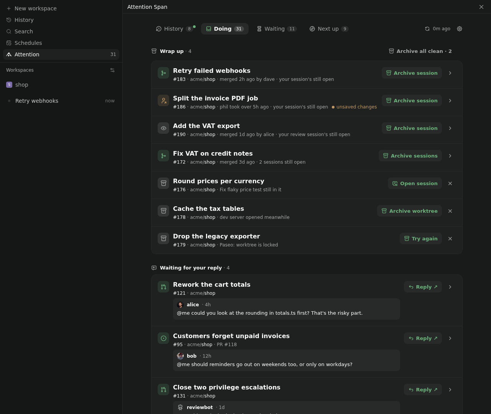
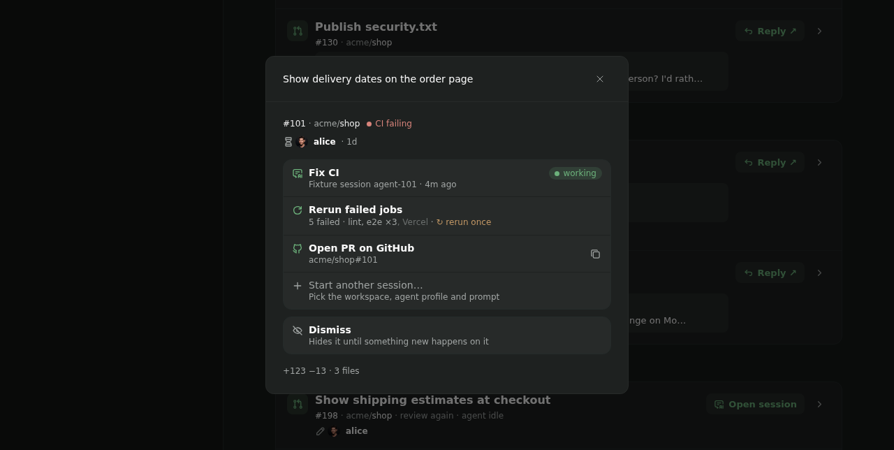
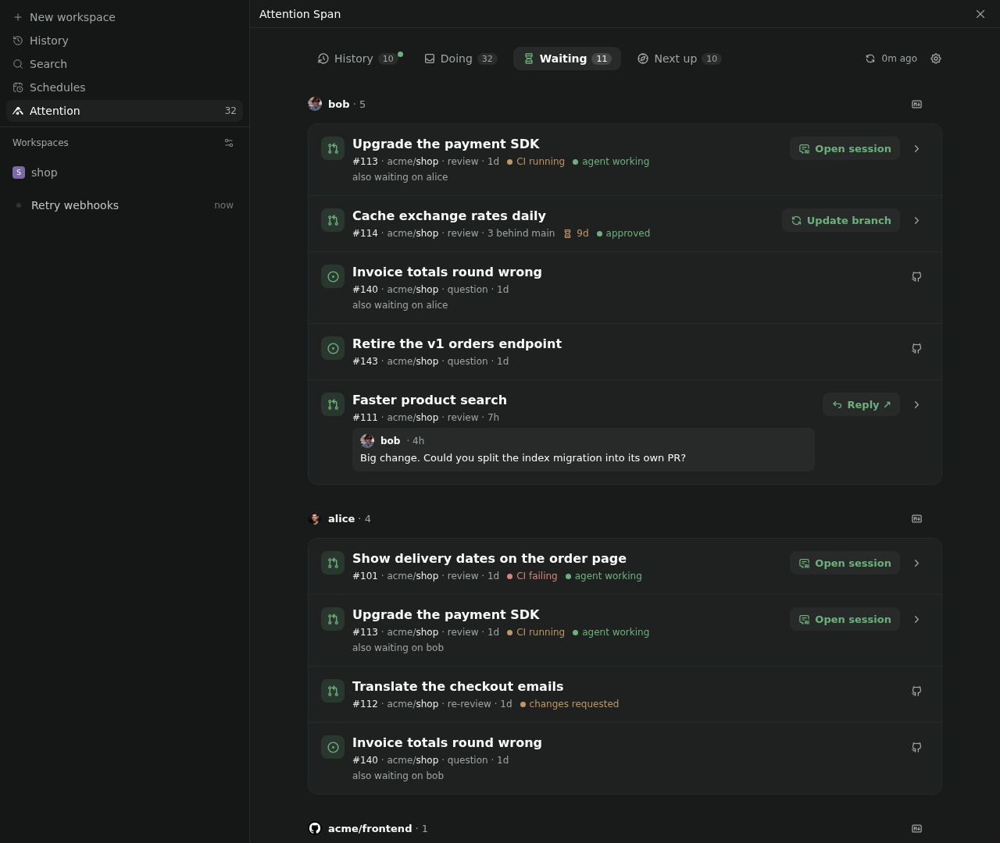
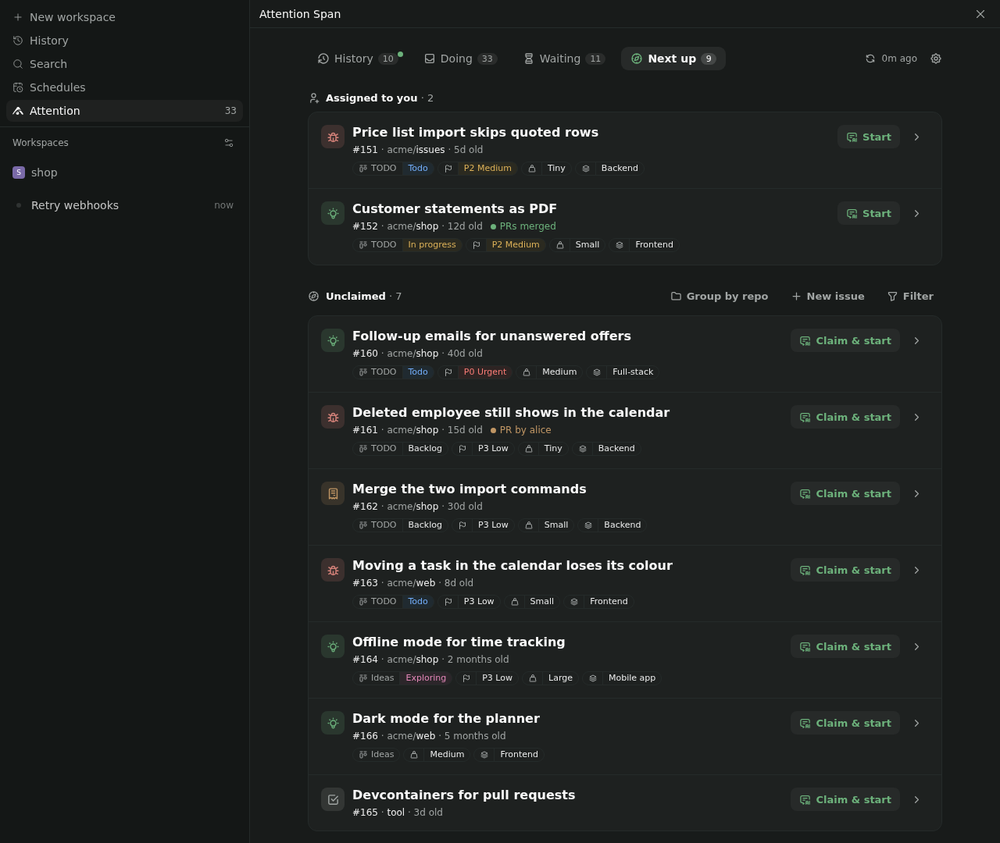
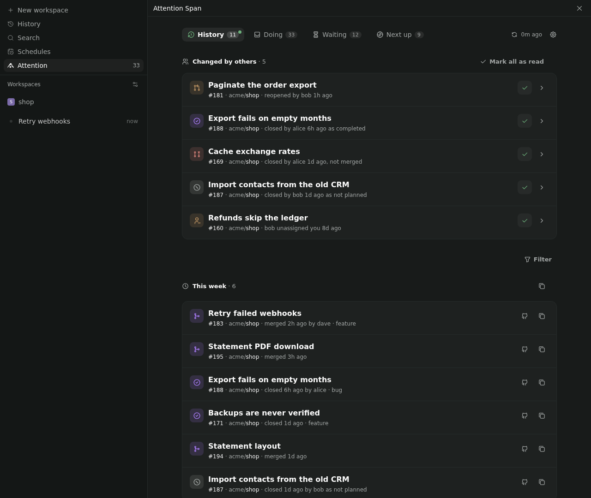

I made Attention Span because my attention was getting spread across too many repos, reviews and agent sessions, and GitHub's answer to that is... more notifications.

So this goes the other way. You get one short list of the issues and PRs that are actually waiting on you, grouped by *why*, and a button to start a Paseo agent session when you want help. The sidebar entry shows a count, so you can ignore it with confidence.

There are four tabs: what needs me now, what's out of my hands, what I'll pick up next, and what I actually got done.

## Doing

This is the tab you'll live in. Items are grouped by reason: someone's waiting for your reply, a review was requested, CI is failing, it's ready to merge, and so on. Each item shows up once, under its most urgent reason. An issue and the PRs that close it count as one item, and so does a stack of PRs.

At the top is **Wrap up**. It lists merged, closed or handed-off work that still has a Paseo session open. Archive puts the session and its worktree away. It leaves alone worktrees another session still uses, and your own checkout. It also checks for uncommitted or unpushed work first, because there's no Undo.

Every item has one main button that matches why it's there: Reply, Review, Fix CI, Merge. Open the item to see every action, each with a line saying what it'll do. I wanted buttons you can press without wondering what's about to happen to your repo.

Mentions clear when you reply or react. Team mentions don't count, because "@everyone-in-backend" isn't really a question for *me*. If something's just an FYI, dismiss it.

## Waiting

This is your work where someone else has the next move: a review you asked for, CI running, a question nobody's answered. It's grouped by who you're waiting on. After three days an item turns amber, but only when a nudge would be fair. **Copy list** gives you that person's items as Markdown, ready to paste into a message.

Otherwise there's nothing to do here, and that's kind of the point. It's tracked, so you can stop holding it in your head.

## Next up

For when your plate is clear. It does happen. Issues assigned to you come first, then unclaimed ones from the repos you point it at. If your org uses issue fields for priority and effort, it ranks by those. It also shows whether someone already has a PR open, which has saved me from redoing a colleague's work more than once.

**Start** launches an agent that reads the issue and proposes a plan. **New issue** (also in ⌘K) takes a line or two, and an agent turns that into a proper issue. It checks for duplicates and shows you the result before anything goes to GitHub.

## History

What you finished in recent weeks, grouped by week. There's a copy button per week for a Markdown list, tagged 🐞 bug, 🚀 feature or 🔧 task. That's my standup prep now. It takes about four seconds.

Things other people did to your work, like merging your PR or taking an issue over, wait at the top until you've seen them. None of it is a to-do, but it shouldn't happen behind your back either.

## Agent sessions

Review reviews and reports back. It doesn't post anything, so you're still the one with opinions in public. Fix CI and Address comments commit but don't push. Rebase and Refresh draft push only if the rebase had no conflicts. Everything else (merge, rerun jobs, request review) changes GitHub right away, so merge and close ask first, and most actions offer an Undo. I mis-tap more than I'd like to admit.

Sessions start in a worktree with the item's context already in the prompt. Once an item has a session, its button opens that session instead of starting another.

## Setup

- `gh` installed and signed in on the machine running the Paseo daemon. The plugin borrows that sign-in and keeps no token of its own.
- Your repos registered as Paseo projects with their GitHub remote, so it can start sessions in them. Items from other repos still show up; you just open them on GitHub.
- Paseo 0.13.0 or later. I've only tested it on Linux, so other platforms are either a pleasant surprise or a bug report.

If `gh` is missing or signed out, or `config.json` won't parse, you get a checklist instead of the lists. You don't need to configure anything to start. The gear on the screen covers orgs, repos and where Next up looks. The rest (agent profiles, prompts, merge methods) lives in `~/.config/paseo-attention-span/config.json`, in JSON. Sorry.

It doesn't read your GitHub notifications. It searches GitHub for what needs you, so you can [turn notifications off](https://github.com/settings/notifications) without missing anything it would have shown you. I did, and it's been nice.

## Your data

- **GitHub:** it reads through `gh`, limited to what you've configured. The default 15-minute refresh uses about 7% of the hourly API allowance. I checked.
- **Local:** a cache and your dismissals live in `~/.config/paseo-attention-span/state.json`. That's it.
- **Updates:** about twice a day it asks Paseo whether there's a newer version. Nothing installs until you tap Update.
- **Agent providers:** a session's prompt carries the item's context (comments, review threads, CI logs) to whichever provider your agent profile uses.

It's github.com only for now. If your setup breaks it, I'd honestly like to hear about it.
