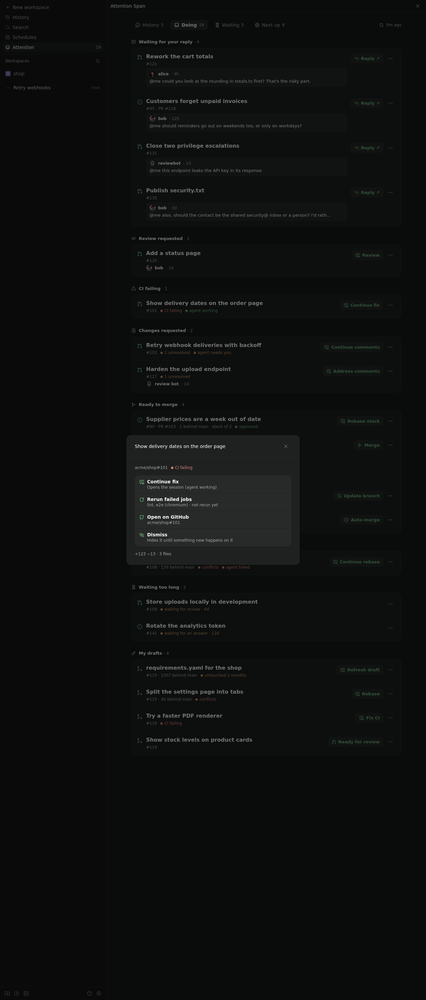
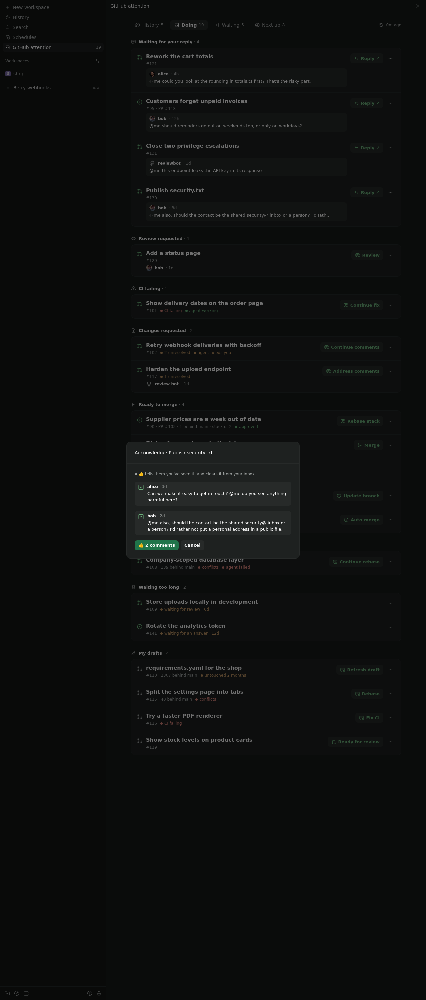
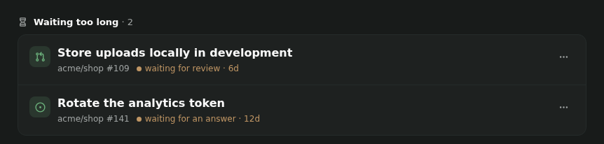
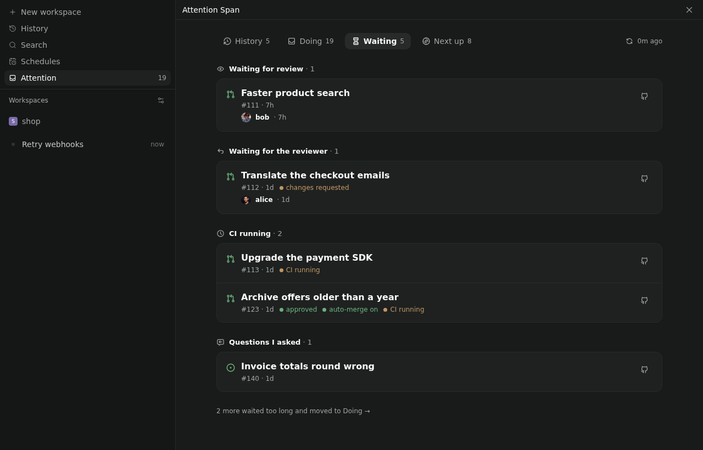
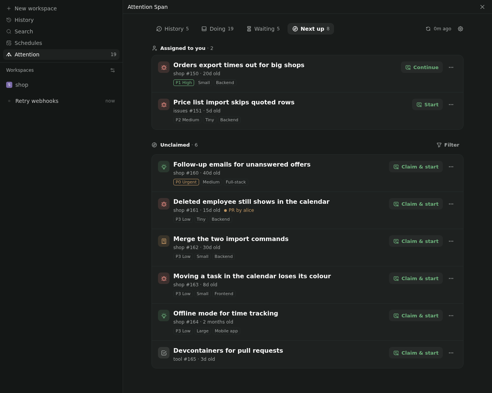
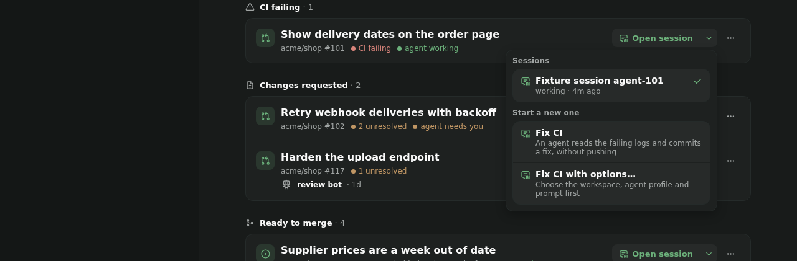
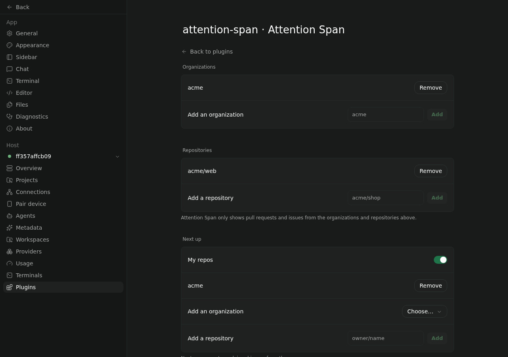

I made Attention Span because my attention was getting spread across too many repositories, reviews and agent sessions, and GitHub's answer to that is... more notifications.

So this is the opposite: one short list of the issues and pull requests that are actually waiting on you, grouped by *why*, with a button to start a Paseo agent session when you'd like help. The Attention entry in the sidebar shows a count, so you can ignore it with confidence.

There are four tabs. I think of them as a little story: what needs me now, what's out of my hands, what I'll pick up next, and what I actually got done.

## Doing: what needs you now

This is the one you'll live in. It's split by reason: someone's waiting for your reply, a review's been requested, CI's failing, changes were requested, it's ready to merge, it needs upstream, it's waited too long, or it's one of your drafts.

Each item shows up once, under whichever reason is most urgent. An issue and the PRs that close it count as one item, and so does a stack of PRs. A stack is one change wearing several PRs, so it shouldn't take up five rows.

Mentions only count while the person is still waiting for you. Reply or react and it's gone. Team mentions are left out entirely, because "@everyone-in-backend" is not really a question for *me*. And if something's just an FYI, dismiss it. It stays gone until something new happens on it.

Every item has one main button that matches why it's there: Reply, Review, Fix CI, Merge. Open the item and you get every action, each with a line saying what it'll do. I wanted buttons you can press without wondering what's about to happen to your repo.

Some actions start an agent session:

- **Review** reviews a PR and tells you what it thinks. It doesn't post anything. You're still the one with opinions in public.
- **Fix CI** and **Address comments** commit fixes but don't push.
- **Rebase** rebases a PR or a whole stack, and pushes only if there were no conflicts.
- **Refresh draft** rebases a stale draft and tells you what it still needs. Every draft I've abandoned thanks it.

The rest change GitHub right away: rerun failed jobs, update a branch, mark a draft ready, turn on auto-merge, merge, close a draft. Merge and close ask first. **Acknowledge** reacts 👍 to the comments waiting on you, but only after showing you them in full. Thumbs-upping things you haven't read is a hobby, not a workflow.

Anything that's sat in Waiting for more than three days moves back here under **Waiting too long**. Usually that means someone forgot, and sometimes the someone is me.

## Waiting: out of your hands

This is your work where someone else has the next move: waiting for review, waiting for the reviewer to look again, CI running, or a question you asked that nobody's answered yet.

There's nothing to do here. That's the point. It's tracked, so you can stop holding it in your head.

## Next up: for when your plate is clear

It does happen. Next up lists issues assigned to you first, because finishing what you've taken seems polite, and then open issues nobody's claimed. If your org uses issue fields for priority and effort, it ranks by those, so the important quick wins float to the top. Each issue shows its repo, priority, effort and scope, and whether someone already has a PR open for it. That last one has saved me from duplicating a colleague's work more than once.

Unclaimed issues come from wherever you point it: your own repos, your orgs, or single repos. Point it nowhere and it falls back to your Paseo projects' repos, so it never fills up with strangers' issues. You can filter by source or scope, and it remembers.

**Claim & start** (or just **Start**, if it's already yours) starts an agent that reads the issue and proposes a plan. You can also claim or give back an issue without starting anything, or close one as done or not planned, so the stuff that's never going to happen stops getting suggested to you.

Some orgs keep issues in a separate repo from the code. When that happens, the first Start asks where the code lives and remembers the answer.

## History: what you got done

The issues and PRs you finished in recent weeks, grouped by week, plus the PRs you reviewed that got merged. Reviews are work too, even if nobody counts them.

There's a copy button per week that gives you a Markdown list of links. That's my standup prep now, and it takes about four seconds.

## Agent sessions

Actions with an agent icon start a session; the rest change GitHub right away. Where GitHub allows it, an Undo shows up afterwards, because I mis-tap more than I'd like to admit.

Sessions run in a worktree of the registered project, or pick up the existing workspace for that branch. They start with the item's context already in the prompt: failing checks, unresolved comments, the issue's discussion. Once an item has a session, its main button opens that session instead of starting another, and the ▾ next to it lets you pick a different one or start fresh on purpose.

## However you use GitHub

I've tried not to bake in one way of working. It needs no configuration to start with, and so far it copes with:

- **Working alone:** with nothing configured, it covers everything on GitHub that involves you, and Next up looks at your Paseo projects' repos.
- **A team that reviews everything:** review requests, changes requested, waiting on reviewers and ready to merge each get their own spot.
- **Stacked PRs:** a stack is one item and rebases as one.
- **Issues first:** an issue and the PRs that close it are one item, and your org's issue fields rank Next up.
- **Issues kept apart from the code:** Start asks once where the code lives.
- **Open source:** mentions clear when you reply or react, and work waiting on maintainers sits in Waiting until it's waited too long.

If your setup breaks it, I'd honestly like to hear about it.

## Turning off GitHub notifications

Attention Span doesn't read your notifications at all. It searches GitHub for what needs you. So if notifications bury you, you can turn them off and not miss anything it would have shown you. They're at [github.com/settings/notifications](https://github.com/settings/notifications):

- Turn off **Automatically watch repositories** and **Automatically watch teams**, so you don't get subscribed to every new repo you're given access to.
- Under **Watching** and **Participating, @mentions and custom**, clear On GitHub, Email and CLI.
- Under System, clear **Actions**, or keep only failed workflows if you can't quite let go.
- Unwatch the repos you already watch at [github.com/watching](https://github.com/watching). There are probably more than you'd guess.
- On your phone, turn off push in GitHub Mobile's settings.

GitHub moves these settings around now and then. Their [notification docs](https://docs.github.com/en/account-and-profile/managing-subscriptions-and-notifications-on-github/setting-up-notifications/configuring-notifications) should be current.

## Setup

What it needs:

- The GitHub CLI, `gh`, installed and signed in on the machine that runs the Paseo daemon. The plugin uses that sign-in and doesn't keep a token of its own.
- Your repos registered as Paseo projects, with their GitHub remote, so it can start sessions in them. Items from other repos still show up, and you can open them on GitHub.
- Paseo 0.13.0 or later. I've only tested it on Linux, so other platforms are a pleasant surprise or a bug report.

If `gh` is missing or signed out, or `config.json` won't parse, you get a setup checklist instead of the lists. It says what's missing, how to fix it, and has a button to check again. It also tells you what the plugin covers, how many of your projects it can start sessions in, and which agent the sessions will use.

To narrow things down, pick organizations and repos with the gear on the screen, or under Settings, Plugins, Attention Span. Each one is checked on GitHub as you add it, so typos show up straight away. Next up's unclaimed issues use these too, instead of your projects, unless you give Next up its own sources.

Everything else lives in `~/.config/paseo-attention-span/config.json` on the daemon host. The settings screen writes there too.

- `profiles`: which Paseo agent profile each kind of session uses. Reviews use `review` and everything else uses `default`. A missing profile falls back to Paseo's defaults.
- `prompts`: your own prompt template per session type, if you don't like mine.
- `mergeMethods`: squash, merge or rebase, per repo.
- `codeRepos`: where an issue repo's code lives. The screen asks and fills this in, so you probably won't touch it.
- `nextUp`: where Next up picks from (also in Settings), and which org issue fields mean priority, effort and scope.
- `refreshMinutes` (15), `waitingTooLongDays` (3), `staleDraftDays` (30), `mentionDays` (30) and `historyWeeks` (4).

## Your data

- **GitHub:** it reads your PRs, review requests, mentions and issues through `gh`, limited to the orgs and repos you've configured. By default it refreshes every 15 minutes, which uses under 6% of GitHub's hourly API allowance. I checked.
- **Local files:** a cache of what it shows, your dismissals and your Next up filter live in `~/.config/paseo-attention-span/state.json` on the daemon host. That's it.
- **Agent providers:** when a session starts, the item's context goes into the agent's prompt: descriptions, comments, review threads, failing CI logs. That prompt goes to whichever provider your agent profile uses, so it's worth knowing which one that is.

## What it doesn't do (yet)

- github.com only. No other forges and no GitHub Enterprise, for now.
- Apart from orgs and repos, settings are edited by hand. Yes, in JSON. Sorry.
