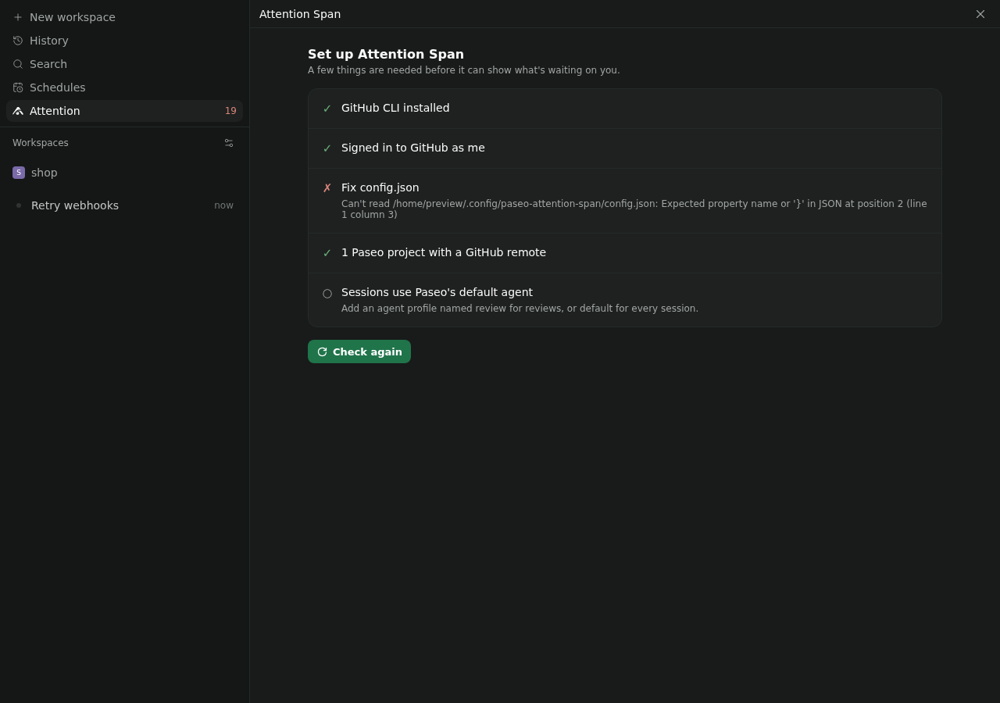

# Attention Span

For when your attention is spread thin. A [Paseo](https://paseo.sh) plugin that lists the GitHub issues and pull requests waiting on you, grouped by why, and starts agent sessions to act on them.


[OVERVIEW.md](OVERVIEW.md) explains what it shows, its actions, its settings and where data goes.

## Install

```bash
paseo plugin add andrioid/attention-span
```

That's the reviewed release from the Paseo plugin registry. For the unreleased latest from `main`, use `paseo plugin add git:andrioid/paseo-attention-span` instead.

Then open Attention in the sidebar. Until it can reach GitHub, it shows a checklist of what's missing:

- The GitHub CLI, installed and signed in on the machine that runs Paseo: `gh auth login`.
- The repositories you work in, registered as Paseo projects, so items can start sessions.

To narrow it down to some organizations and repositories, use the gear on the screen, or Settings, Plugins, Attention Span. Everything else is in `~/.config/paseo-attention-span/config.json`.



## Develop

See [CONTRIBUTING.md](CONTRIBUTING.md), [requirements.yaml](requirements.yaml) and [docs/architecture.md](docs/architecture.md).

## License

[MIT](LICENSE)
