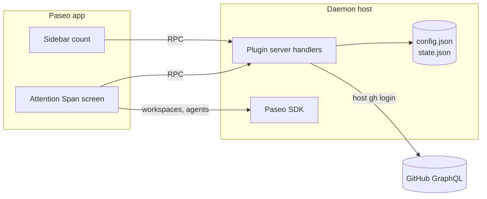
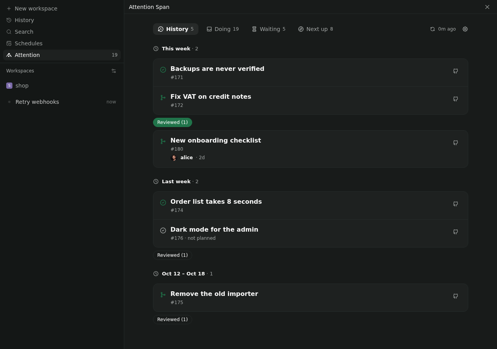
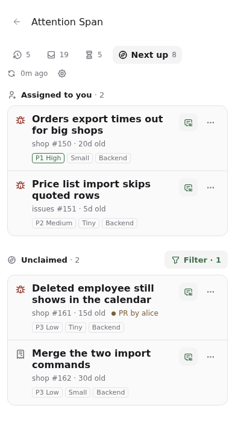

# Architecture

How Attention Span meets [requirements.yaml](../requirements.yaml). Requirement IDs in brackets.

## Pieces

- **Paseo plugin**, installed per daemon.
  - Client: one screen and a sidebar header item. React Native primitives only, so it works on phone and desktop [REACH-01].
  - Server: RPC handlers for fetching and for GitHub actions.
- **GitHub access** goes through the host's existing `gh` login. The plugin stores no token [SEC-01].
- **Setup checklist** [SET-01]: when a refresh fails, the screen asks the server what setup needs (`gh api user` for whether `gh` is there and who it's signed in as, and whether `config.json` parses). If `gh` is missing or signed out, or the file is broken, a checklist takes the tabs' place. Each line says how to fix it, and Check again refreshes. It also lists what's covered, the Paseo projects with a GitHub remote, and which profile sessions will use. Other failures, like a network error, stay a red line above the tabs.
- **Settings screen** [SRC-02], under Settings → Plugins → Attention Span and the gear next to ⟳: orgs and repos, one per row. Each is checked with `gh api users/<org>` (it must be an organization, since searches use `org:`) or `gh api repos/<owner>/<name>` before it's saved, and GitHub's exact name is kept. Saving rewrites only `orgs` and `repos` in `config.json`, refuses a file that doesn't parse, and refreshes the lists.
- **Local files** live in `~/.config/paseo-attention-span/`:
  - `config.json`, edited by hand, except `orgs` and `repos` (the settings screen) and `codeRepos`, which the screen can add to:
    - orgs and repos [SRC-01]
    - a profile per reason: `review` for Review, `default` for everything else
    - `waitingTooLongDays` (default 3) [ATT-11] and `refreshMinutes` (default 15) [FRESH-01], `historyWeeks` (default 4) [HIS-01]
    - optional prompt templates that replace the built-in ones [SES-04]
    - optional merge method per repo [PRS-04]
    - `codeRepos`: where an issue repo's code lives, for issues kept in their own repo [SES-07]
    - `nextUp`: where unclaimed issues come from (`mine`, `orgs`, `repos`, set in Settings) and the org issue fields for priority, effort and scope [NXT-04]
  - `state.json`: dismissals [ATT-08], the scopes and sources ticked in Next up's filter [NXT-03, NXT-09], my Paseo projects' GitHub repos [NXT-08] and the last fetch of each feed, so the screen shows instantly after a restart [PRIV-01].

## Tabs

The tabs tell the story of my work, left to right: what I finished, what needs me, what waits on others, what's next. The screen opens on **Doing**, and the sidebar entry "Attention" shows Doing's count [ATT-09]. On phones only the active tab shows its label.

| Tab | Shows |
|---|---|
| History | The last `historyWeeks` (default 4) by week, newest first, in the device's time zone: issues assigned to me that closed, with the PRs that closed them, and my other merged PRs [HIS-01]. Per week, a collapsed "Reviewed (n)" lists others' merged PRs I reviewed [HIS-02]. The copy icon on a week's heading copies its finished items, not the reviews, as a Markdown list of links; an issue and the PRs that closed it are one line, linking the issue [HIS-03]. |
| Doing | The sections below |
| Waiting | My work where someone else has the next move [WAI-01]: *Waiting for review* (with the requested reviewer), *Waiting for the reviewer* (after I replied or pushed), *CI running*, *Questions I asked* (issues where I commented last) |
| Next up | *Assigned to you* [NXT-06], then *Unclaimed* [NXT-01] |

Screenshots, from the preview's made-up data, are in [screenshots/](screenshots/). Refresh them with `npm run screenshots`.

| Doing | History | Next up (phone) |
|---|---|---|
|  |  |  |

### Doing

Top to bottom. Each item appears once, under its most urgent reason [ATT-02].

| Section | Shows |
|---|---|
| Waiting for your reply | Open threads with a mention waiting on me [MEN-01] |
| Review requested | PRs requesting my review by name, not via a team [REV-01] |
| CI failing | My PRs with failing checks [PRS-01] |
| Changes requested | My PRs with requested changes or unresolved threads [PRS-02] |
| Ready to merge | My approved, mergeable PRs [PRS-03] |
| Needs upstream | My PRs with conflicts or an out-of-sync stack [UPS-01, UPS-02] |
| Waiting too long | Waiting items older than `waitingTooLongDays` (default 3); it's mine to nudge [ATT-11] |
| My drafts | My drafts, with their own state tags [PRS-05, PRS-06] |

## Rules

- **One item per issue** [ATT-03]: PRs are grouped under the issues they close (`closingIssuesReferences`, works across repos). A PR without a linked issue is its own item.
- **One item per stack** [ATT-04]: a stack is followed through base/head branch names. Its section is decided by the bottom PR; the PRs above it are listed beneath.
- **Mentions** [MEN-01..06]: a thread counts when a person @-mentioned me after my last comment, review or reaction there. Team mentions are ignored. A bot counts only when it opened a thread I need to resolve, and is marked with 🤖. The quote on a card is cut around the mention, so it's shown as plain text: links keep their text, Markdown marks and quoted replies go.
- **Handed over** [PRS-08]: my PRs assigned to someone else, and not to me, are left out. Mentions of me on them still count.
- **Dismiss** [ATT-08] hides an item until someone other than me comments, reviews or pushes, or its reason changes. My own actions and CI reruns don't bring it back.
- **Behind base** [UPS-07] only matters when:
  1. the PR conflicts with its base,
  2. a stacked PR no longer builds on its parent's head,
  3. it is ready to merge (CI ran against an old base).
  Otherwise the behind count is shown on rows that appear anyway, but never puts an item on the list by itself. Its chip stays neutral; only conflicts are flagged, in red.
- **Stale draft** [PRS-07]: a draft untouched for 30 days offers Refresh and Close instead of Rebase.

## Next up

A second tab lists open issues nobody is assigned to [NXT-01], from the sources chosen under Next up in Settings: my own repos (`user:<login>`, forks left out), orgs I belong to (picked from `viewer.organizations`), and single repos checked on GitHub [NXT-04]. Each source is its own search, so an issue knows which sources found it and no query outgrows GitHub's length limit; one found by several is listed once. With more than one source, the Filter button on Unclaimed also filters by source, and what I tick is saved in `state.json` [NXT-09]. With no sources chosen, it looks in the configured orgs and repos. With neither, it looks in the GitHub repos of my Paseo projects, listed at each refresh through the app's last connection and kept in `state.json` for refreshes before the app connects; with no projects either, it says where to add some [NXT-08]. Unlike the other searches it isn't about me, so it never runs across all of GitHub. They are ordered by priority, then effort, then age [NXT-02]. Priority and effort are org issue fields named in `config.json`; a value ranks by the configured `order` (matched by name, so "Small" matches "🐇 Small (0.5-2d)") or else by the field's own option order. Issues without a value go last. Each card shows the repo's name and number, its age, and priority, effort and scope as tags with the org's emoji and notes in brackets trimmed; the top two priorities are tinted. An open PR that closes the issue (`closedByPullRequestsReferences`, from the same search) shows as "PR by alice", without changing the order [NXT-10]. The Filter button on Unclaimed opens a sheet (a dialog on desktop) with a checkbox per source and per scope; ticks apply right away, all are off at first, and what I tick is saved in `state.json` [NXT-03]. **Claim & start** assigns me with `gh issue edit --add-assignee @me`, then starts a "start" session on a new branch [NXT-05]. Each row's sheet shows the issue's PRs, and offers **Claim** without starting, or **Unclaim** (`--remove-assignee @me`) on issues assigned to me; each is the other's Undo [NXT-07].

## Actions

A card shows its main action and ⋯. Tapping the card or ⋯ opens its **sheet**, a bottom sheet on phones and a dialog on desktop [ATT-06]. When the sheet would hold a single action, as on Waiting and History cards where it's only Open PR (or issue) on GitHub, the card shows that action instead of ⋯; tapping the card still opens the sheet. History cards also have a copy icon that copies the item's URL [ATT-15]. Top to bottom, the sheet has:

1. **What the card knows:** repo#number, its chips, the full quote and the full stack. Each PR in the stack opens on GitHub, so an issue's PRs are a tap away [ATT-12].
2. **Every action,** each with a line saying what it will do, then "… with options" for session actions [SES-02], Open issue or Open PR on GitHub [ATT-12], with a copy icon at its end that copies the URL without adding a line [ATT-15], and Dismiss [ATT-08].
3. **What's fetched when it opens,** in one GraphQL request, so the refresh stays as light as before [GH-01]: the PR's size and the linked issue or PRs, leaving out PRs the stack already shows. It comes last so the actions don't move when it arrives. The description isn't shown; making sense of it takes GitHub anyway.

An agent icon (Tabler's `message-ai`, a speech bubble with "AI") marks every action that starts or continues an agent session, marked *(agent)* below; the rest change GitHub right away [ATT-13]. GitHub actions don't ask first, apart from Merge and Close. Instead an Undo row appears, where GitHub can take it back, until I switch tabs [ATT-14].

| Action | Shown when | Does |
|---|---|---|
| Reply ↗ | Mention waiting | Opens the comment on GitHub [ATT-12] |
| Acknowledge | Mention waiting | Lists every waiting comment in full, rendered as Markdown with Paseo's renderer (cut after whole blocks, up to about 4,000 characters), all ticked; 👍 on the ones I keep ticked (`addReaction`), which clears them [MEN-07]. Undo removes them. |
| Review *(agent)* | Review requested | Session in a PR checkout using the review profile [SES-01] |
| Fix CI / Address comments *(agent)* | CI failing / changes requested | Session with the failing log or unresolved threads in the prompt [SES-04] |
| Rerun failed jobs | CI failing, in the sheet | `gh run rerun --failed` for each failing GitHub Actions run of the PR, or of every PR in its stack. The sheet names the failed checks and how often they were rerun (`gh api …/runs/<id>`), fetched when it opens. Other status checks can't be rerun from here [PRS-09]. |
| Update branch | Behind with no conflicts, not stacked | `updatePullRequestBranch` (rebase) [UPS-03] |
| Rebase / Refresh *(agent)* | Conflicts, any stacked PR, stale draft | Agent rebases the PR, or the whole stack with `git rebase --update-refs` [UPS-04]. A clean rebase is pushed with `--force-with-lease` [UPS-06]. After resolving conflicts it stops and explains, and pushes only when I reply "push" in its session [UPS-05]. |
| Ready for review | My draft with CI not failing, no conflicts, not stale | `markPullRequestReadyForReview` on the bottom PR; Undo converts it back to a draft [PRS-11] |
| Auto-merge | Approved, CI running, and the repo allows auto-merge | `enablePullRequestAutoMerge` with the merge method below and the head I saw. The PR then waits in *CI running* with an "auto-merge on" chip; Undo turns it off [PRS-10] |
| Merge | Approved, CI green on current base | `mergePullRequest` with the repo's method from `config.json`, otherwise the first the repo allows of squash, merge, rebase [PRS-04]. Asks first. |
| Close draft | Stale draft, in the sheet | `closePullRequest`, with a comment only if I write one [SAFE-01]. Asks first. |

A tap starts with defaults. An existing workspace for the branch or PR is resumed instead of creating a new one [SES-03, ATT-07]. Collapsed, a stack shows only the PRs that need attention [ATT-04].

## Sessions

- **Repo to checkout** [SES-05]: match the PR's or issue's repository against the git remotes of registered Paseo projects. Repos without a project can only open GitHub.
- **Issues kept apart from the code** [SES-07]: an issue starts in the repo `codeRepos` maps its repo to, from that repo's default branch (one `gh repo view`). When neither has a project, Start asks which project holds the code, saves the answer to `codeRepos` and carries on. Claim waits until then, so a start that can't go anywhere doesn't leave the issue taken. The prompt and Claim keep using the issue's own repo.
- **Workspace**: a worktree with `checkout-pr` for PRs, or `branch-off` from the default branch for issues.
- **Profile**: looked up per reason in `config.json`, then materialised into `create_agent` from `list_profiles`. A missing `review` profile falls back to `default`; a missing `default` starts the agent with Paseo's defaults. Options ▾ still offers provider and model [SES-06].
- **Prompt**: a built-in template per session type, filled with the item's context. A template in `config.json` replaces the built-in one [SES-04]. The context is fetched when the session starts, mostly from `gh`'s JSON output: `gh pr checks` and `gh run view --log-failed` for Fix, `gh pr view`/`gh issue view` for Review and Start, one GraphQL query for unresolved threads for Address. Rebase uses the stack already in the item.

## GitHub requests

Light on GitHub's API [GH-01], and quick when I press ⟳. Attention Span has two feeds, each with its own cache, schedule and error:

- **Live** feeds Doing, Waiting and Next up.
- **History** feeds History.

### Live

One GraphQL request per search, sent in parallel. GitHub runs the searches in one request one after another, so a combined request took about 5 seconds where parallel ones take about 2.

- `is:pr is:open author:@me` (also asks for the viewer's login, and whether auto-merge is on and allowed)
- `is:pr is:open user-review-requested:@me` (personal requests only)
- `is:open mentions:@me updated:>=<30 days ago>` (fetching the description, recent comments, review-thread comments, their IDs for 👍, and `viewerHasReacted`)
- `is:issue is:open assignee:@me`
- `is:issue is:open commenter:@me` (for issues waiting on others)
- `is:issue is:open no:assignee` (Next up, with issue type and field values; one request per source [NXT-09], skipped when there's nowhere to look [NXT-08]). "My repos" needs my login, taken from the last fetch or asked once with `viewer { login }`

Once my PRs and both issue searches are back, one batched **details** request asks for `Ref.compare` behind counts for my PRs, and the option order of org issue fields when Next up needs it. The other searches carry on meanwhile.

A live refresh is 7 requests and about 70 points, of the 5,000 GitHub allows per hour. Points depend on how much a query asks for, not how many requests carry it; my PRs (34) and review requests (20) cost the most.

### History

One request with three searches, each from the Monday `historyWeeks` back: `is:pr is:merged author:@me`, `is:pr is:merged reviewed-by:@me -author:@me`, `is:issue is:closed assignee:@me`. About 1 point.

Every search is scoped to the configured orgs and repos; Next up's unclaimed issues as described under Next up.

### When

It's a digest, not a live view. Opening the screen shows the cache. ⟳ fetches only the feed behind the tab I'm on.

| Feed | Fetched |
|---|---|
| Live | Every `refreshMinutes` (default 15, at least 5) in the background [FRESH-01], after my own actions, and on ⟳ |
| History | Once a day in the background, after a merge from Attention Span, and on ⟳ in History. Things I finish outside Attention Span show up by the next day. |

A failed refresh is retried at most every 5 minutes. At the default 15 minutes that's about 28 requests and 280 points an hour, under 6% of GitHub's hourly allowance. Actions use GraphQL mutations or `gh`. Session context is fetched only when a session starts, and a sheet's details only when it opens.

