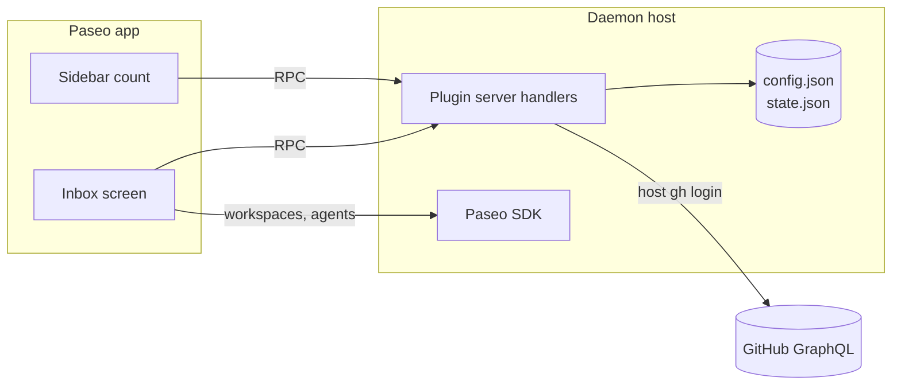

# Architecture

How the inbox meets [requirements.yaml](../requirements.yaml). Requirement IDs in brackets.

## Pieces

- **Paseo plugin**, installed per daemon.
  - Client: one screen and a sidebar header item. React Native primitives only, so it works on phone and desktop [REACH-01].
  - Server: RPC handlers for fetching and for GitHub actions.
- **GitHub access** goes through the host's existing `gh` login. The plugin stores no token [SEC-01].
- **Local files** live in `~/.config/paseo-github-inbox/`:
  - `config.json`, edited by hand:
    - orgs and repos [SRC-01]
    - a profile per reason: `review` for Review, `default` for everything else
    - `waitingTooLongDays` (default 3) [ATT-11] and `refreshMinutes` (default 30) [FRESH-01]
    - optional prompt templates that replace the built-in ones [SES-04]
    - optional merge method per repo [PRS-04]
  - `state.json`: dismissals [ATT-08] and the last fetched result, so the inbox shows instantly after a restart [PRIV-01].

## Sections

Top to bottom. Each item appears once, under its most urgent reason [ATT-02].

| Section | Shows |
|---|---|
| Waiting for your reply | Open threads with a mention waiting on me [MEN-01] |
| Review requested | PRs requesting my review by name, not via a team [REV-01] |
| CI failing | My PRs with failing checks [PRS-01] |
| Changes requested | My PRs with requested changes or unresolved threads [PRS-02] |
| Ready to merge | My approved, mergeable PRs [PRS-03] |
| Needs upstream | My PRs with conflicts or an out-of-sync stack [UPS-01, UPS-02] |
| My drafts | My drafts, with their own state tags [PRS-05, PRS-06] |
| Footer | Expandable counts: waiting on others, to do (assigned issues), done this week [ATT-10] |

**Waiting on others** is:
- my PRs waiting for review,
- my PRs where I replied to a review and the reviewer hasn't come back,
- my PRs waiting on CI,
- issues where I commented last and nobody has answered.

It stays in the footer until it has waited `waitingTooLongDays` (one value, default 3), then appears as "Waiting too long" [ATT-11].

## Rules

- **One item per issue** [ATT-03]: PRs are grouped under the issues they close (`closingIssuesReferences`, works across repos). A PR without a linked issue is its own item.
- **One item per stack** [ATT-04]: a stack is followed through base/head branch names. Its section is decided by the bottom PR; the PRs above it are listed beneath.
- **Mentions** [MEN-01..06]: a thread counts when a person @-mentioned me after my last comment or reaction there. Team mentions are ignored. A bot counts only when it opened a thread I need to resolve, and is marked with 🤖.
- **Handed over** [PRS-08]: my PRs assigned to someone else, and not to me, are left out. Mentions of me on them still count.
- **Dismiss** [ATT-08] hides an item until someone other than me comments, reviews or pushes, or its reason changes. My own actions and CI reruns don't bring it back.
- **Behind base** [UPS-07] only matters when:
  1. the PR conflicts with its base,
  2. a stacked PR no longer builds on its parent's head,
  3. it is ready to merge (CI ran against an old base).
  Otherwise the behind count is shown on rows that appear anyway, but never puts an item on the list by itself.
- **Stale draft** [PRS-07]: a draft untouched for 30 days offers Refresh and Close instead of Rebase.

## Actions

| Action | Shown when | Does |
|---|---|---|
| Reply ↗ | Mention waiting | Opens the comment on GitHub [ATT-12] |
| Review ▸ | Review requested | Session in a PR checkout using the review profile [SES-01] |
| Fix ▸ / Address ▸ | CI failing / changes requested | Session with the failing log or unresolved threads in the prompt [SES-04] |
| Update ▸ | Behind with no conflicts, not stacked | `updatePullRequestBranch` (rebase) [UPS-03] |
| Rebase ▸ / Refresh ▸ | Conflicts, any stacked PR, stale draft | Agent rebases the PR, or the whole stack with `git rebase --update-refs` [UPS-04]. A clean rebase is pushed with `--force-with-lease` [UPS-06]. After resolving conflicts it stops and explains, and pushes only when I reply "push" in its session [UPS-05]. |
| Merge ▸ | Approved, CI green on current base | `mergePullRequest` with the repo's method from `config.json`, otherwise the first the repo allows of squash, merge, rebase [PRS-04] |
| Close ▸ | Stale draft | `closePullRequest`, with a comment only if I write one [SAFE-01] |

A tap starts with defaults. Expanding the row offers workspace, profile, and prompt [SES-02]. An existing workspace for the branch or PR is resumed instead of creating a new one [SES-03, ATT-07].

## Sessions

- **Repo to checkout** [SES-05]: match the PR's or issue's repository against the git remotes of registered Paseo projects. Repos without a project can only open GitHub.
- **Workspace**: a worktree with `checkout-pr` for PRs, or `branch-off` from the default branch for issues.
- **Profile**: looked up per reason in `config.json`, then materialised into `create_agent` from `list_profiles`. A missing `review` profile falls back to `default`; a missing `default` starts the agent with Paseo's defaults. Options ▾ still offers provider and model [SES-06].
- **Prompt**: a built-in template per session type, filled with the item's context. A template in `config.json` replaces the built-in one [SES-04].

## GitHub requests

Fewest requests practical [GH-01]. A refresh is two GraphQL requests.

1. **One query with search aliases**:
   - `is:pr is:open author:@me`
   - `is:pr is:open user-review-requested:@me` (personal requests only)
   - `is:open mentions:@me updated:>=<30 days ago>` (fetching the description, recent comments, review-thread comments, and `viewerHasReacted`)
   - `is:issue is:open assignee:@me`
   - `is:issue is:open commenter:@me` (for issues waiting on others)
   - `is:pr is:merged author:@me merged:>=<monday>`

   Each is scoped to the configured orgs and repos. With comment bodies for the mention rule, the query costs about 50 of 5,000 points per hour.
2. **One batched `Ref.compare` query** for behind counts, only for stacked and ready-to-merge PRs.

Refresh happens when the screen opens, on ⟳, and every `refreshMinutes` (default 30) for the count [FRESH-01]: about 4 requests and 120 points an hour in the background. Actions use GraphQL mutations. The only other call is fetching a failing CI log, and only when a Fix session starts.

