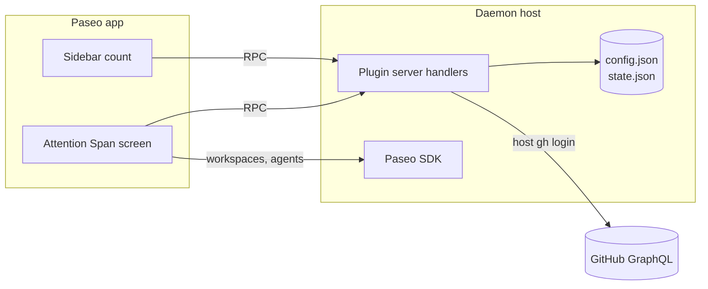
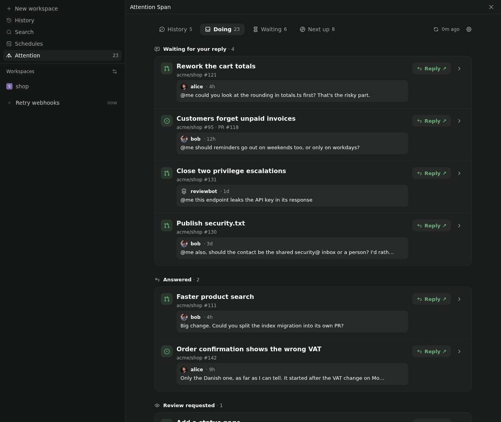
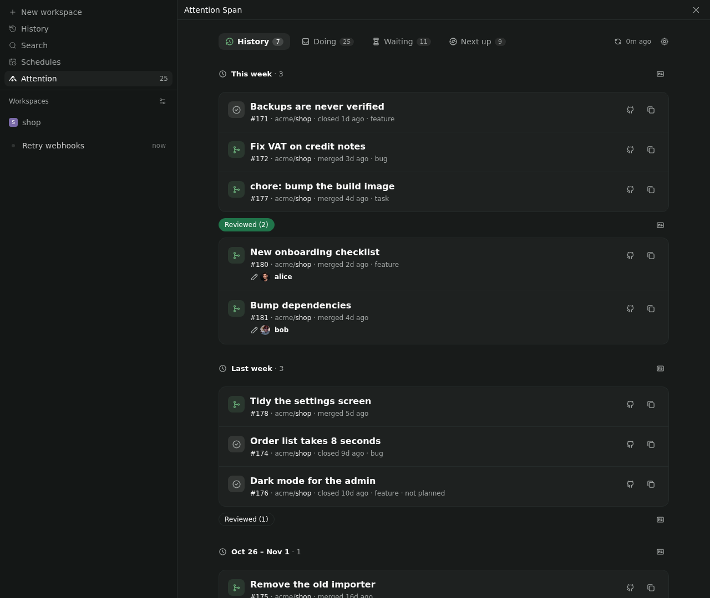
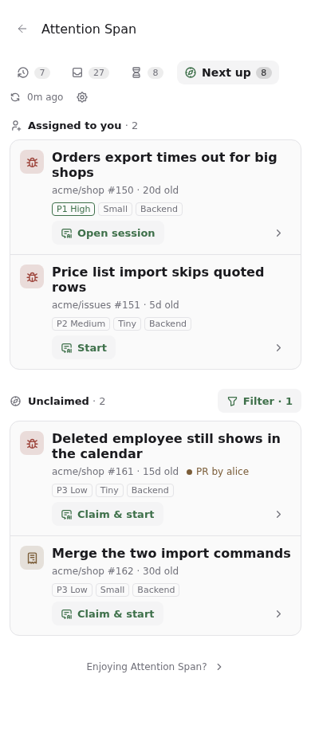

# Architecture

How Attention Span meets [requirements.yaml](../requirements.yaml). Requirement IDs in brackets.

## Pieces

- **Paseo plugin**, installed per daemon.
  - Client: one screen and a sidebar header item. React Native primitives only, so it works on phone and desktop [REACH-01].
  - Server: RPC handlers for fetching and for GitHub actions.
  - With several hosts, each runs its own copy, with its own `gh` login, `config.json` and `state.json`. Paseo shows one sidebar row for all of them and switches hosts with the picker in the screen's header; the row follows the host in view, else the one picked last.
- **GitHub access** goes through the host's existing `gh` login. The plugin stores no token [SEC-01].
- **Setup checklist** [SET-01]: when a refresh fails, the screen asks the server what setup needs (`gh api user` for whether `gh` is there and who it's signed in as, and whether `config.json` parses). If `gh` is missing or signed out, or the file is broken, a checklist takes the tabs' place. Each line says how to fix it, and Check again refreshes. It also lists what's covered, the Paseo projects with a GitHub remote, and which profile sessions will use. Other failures, like a network error, stay a red line above the tabs.
- **Settings screen** [SRC-02], under Settings → Plugins → Attention Span and the gear next to ⟳: orgs and repos, one per row. Each is checked with `gh api users/<org>` (it must be an organization, since searches use `org:`) or `gh api repos/<owner>/<name>` before it's saved, and GitHub's exact name is kept. Saving rewrites only `orgs` and `repos` in `config.json`, refuses a file that doesn't parse, and refreshes the lists. A Replies section has one switch, Follow threads I've commented on, which writes only `followThreads` [ATT-17].
- **Local files** live in `~/.config/paseo-attention-span/`:
  - `config.json`, edited by hand, except `orgs` and `repos` (the settings screen) and `codeRepos`, which the screen can add to:
    - orgs and repos [SRC-01]
    - a profile per reason: `review` for Review, `default` for everything else
    - `followThreads` (default off, also under Settings → Replies → Follow threads I've commented on): recent replies after mine on other people's threads show under Answered [ATT-17]
    - `waitingTooLongDays` (default 3) [ATT-11] and `refreshMinutes` (default 15) [FRESH-01], `historyWeeks` (default 4) [HIS-01]
    - optional prompt templates that replace the built-in ones [SES-04]
    - optional merge method per repo [PRS-04]
    - `codeRepos`: where an issue repo's code lives, for issues kept in their own repo [SES-07]
    - `nextUp`: where unclaimed issues come from (`mine`, `orgs`, `repos`, set in Settings) and the org issue fields for priority, effort and scope [NXT-04]
  - `state.json`: dismissals [ATT-08], the scopes and sources ticked in Next up's filter [NXT-03, NXT-09], my Paseo projects' GitHub repos [NXT-08] and the last fetch of each feed, so the screen shows instantly after a restart [PRIV-01].

## Tabs

The tabs tell the story of my work, left to right: what I finished, what needs me, what waits on others, what's next. The screen opens on **Doing**, and the sidebar entry "Attention" shows Doing's count [ATT-09]. On phones only the active tab shows its label.

| Tab | Shows |
|---|---|
| History | The last `historyWeeks` (default 4) by week, newest first, in the device's time zone: issues assigned to me that closed, with the PRs that closed them, and my other merged PRs [HIS-01]. Per week, a collapsed "Reviewed (n)" lists others' merged PRs I reviewed [HIS-02]. The copy icon on a week's heading copies its finished items, not the reviews, as a Markdown list of links; an issue and the PRs that closed it are one line, linking the issue [HIS-03]. |
| Doing | The sections below |
| Waiting | My work where someone else has the next move [WAI-01]: *Waiting for review* (once a person or team is asked, or someone else has reviewed; or approved but blocked by a repo rule [PRS-13]), *Waiting for the reviewer* (after I replied or pushed), *CI running*, *Questions I asked* (threads where my comment is the last from a person; bots don't count): on my own issues however old, on others' only while my comment is within `mentionDays` [ATT-11]. Each shows who it waits on, never a guess [WAI-02]: on a PR, the reviewers currently requested and, after I replied, whoever requested changes, but nobody when a repo rule blocks it; on a question, the people and teams my comments since the last answer tag, read from GitHub's rendered comments (`bodyHTML`), where only real accounts and teams I can see are linked, never in code; tags in quotes don't count, and only the last 10 comments are read. Waiting groups it all by who it waits on, not by those reasons [WAI-01]: one group per person or team (a person tagged with other capitals is one), whoever blocks the most items first, ties by whose oldest item has waited longest, then requested bots, who can't be nudged, and last *Not on a person* for work nobody is on record for. In each group, work with a session that needs me leads, then one that's working, then the rest, oldest first; a finished session I've seen doesn't lift it. Work waiting on several is under each, saying "also waiting on" the rest, and counts once in the tab. *Waiting too long* items show here too, flagged "waited too long". Each card says why it waits (review, re-review, question, or nobody asked again after a review that only commented; nothing where its chips say, like approved, blocked by repo rules, or CI running with nobody asked) and since when. A group's **Copy list** copies its items oldest first as a Markdown list, each line led by why and how long ("- Review 2h: [title](url)"), for a nudge; a requested bot gets none [WAI-03]. Outside Waiting, as in *Waiting too long*, one person shows by name, several by picture, named on hover and in the sheet. |
| Next up | *Assigned to you* [NXT-06], then *Unclaimed* [NXT-01] |

Every card in every tab is the same component, `CardRow` in `client/card.tsx` [ATT-05]: a tinted mark for what it is, a title of at most two lines, then "repo #number", when it happened and signal chips, then content only some lists have (tags, a quote, a stack line), and its actions: on the right on desktop, labelled under the text on phones. A change on GitHub asks first in a `ConfirmBar` on the card [SAFE-01]. Tabs differ only in what they pass in: each maps its data to the card's mark, meta, actions and slots. Marks and signals take a tone, never a raw theme color, because some themes draw `accent` close to white.

Screenshots, from the preview's made-up data, are in [screenshots/](screenshots/). Refresh them with `npm run screenshots`.

| Doing | History | Next up (phone) |
|---|---|---|
|  |  |  |

### Doing

Top to bottom. Each item appears once, under its most urgent reason [ATT-02]. `server/rules.ts` has one rule per section: a guard over the flags of the item's state (CI, review, mergeability, draft). The first section in `SECTIONS` order whose rule holds wins, so that order is the priority. A test checks that every combination of a PR's flags lands in a section.

| Section | Shows |
|---|---|
| Waiting for your reply | Open threads with a mention waiting on me [MEN-01] |
| Answered | Issues and PRs I opened where a person commented in the conversation after me, within `mentionDays` (default 30), without mentioning me, and I haven't 👍'd it; opening a thread counts as my last word until I comment. Replies after mine on other people's threads count only with `followThreads` on (Settings → Replies → Follow threads I've commented on, off by default); then my comment must be among the thread's last 10. Reply and Acknowledge clear it, and so does Dismiss until someone comments again [ATT-16, ATT-17, MEN-02] |
| Review requested | PRs requesting my review by name, not via a team [REV-01] |
| CI failing | My PRs with failing checks [PRS-01] |
| Changes requested | My PRs with requested changes or unresolved threads [PRS-02] |
| Ready to merge | My approved PRs without conflicts or failing checks, that GitHub's rules let me merge [PRS-03, PRS-13] |
| Needs upstream | My PRs with conflicts or an out-of-sync stack [UPS-01, UPS-02] |
| Waiting too long | Waiting items older than `waitingTooLongDays` (default 3); it's mine to nudge [ATT-11] |
| Needs a reviewer | My PRs nobody has been asked to review, even while CI runs [PRS-12] |
| My drafts | My drafts, with their own state tags [PRS-05, PRS-06] |

## Rules

- **One item per issue** [ATT-03]: PRs are grouped under the issue they work on, across repos. GitHub links (`closingIssuesReferences`) only PRs into the default branch, so a stack's upper PRs are read too. For a stack, strongest evidence first: what GitHub links on any of its PRs, bottom first; then a closing keyword ("Closes #N") in any PR's description; then the one issue the bottom PR's description mentions ("First of three for #N"), and none when it mentions several. Code, quotes and template comments don't count. References from descriptions are looked up in the details request, and only open issues count, so a reference to a PR doesn't group. A PR without an issue is its own item. History does the same per merged PR, against the closed issues it lists.
- **One item per stack** [ATT-04]: a stack is followed through base/head branch names. Its section is decided by the bottom PR; the PRs above it are listed beneath.
- **Answers** [ATT-16]: on an issue a PR of mine closes, an answer leads the item like a mention does. From the issue itself only what's on me counts; its PRs say how the work is going.
- **Mentions** [MEN-01..06]: a thread counts when a person @-mentioned me after my last comment, review or reaction there. Team mentions are ignored. A bot counts only when it opened a thread I need to resolve, and is marked with 🤖. The quote on a card is cut around the mention, so it's shown as plain text: links keep their text, Markdown marks and quoted replies go.
- **Handed over** [PRS-08]: my PRs assigned to someone else, and not to me, are left out. Mentions of me on them still count.
- **Dismiss** [ATT-08] hides an item until someone other than me comments, reviews or pushes, or its reason changes. My own actions and CI reruns don't bring it back.
- **Behind base** [UPS-07] only matters when:
  1. the PR conflicts with its base,
  2. a stacked PR no longer builds on its parent's head,
  3. it is ready to merge (CI ran against an old base).
  Otherwise the behind count is shown on rows that appear anyway, but never puts an item on the list by itself. Its chip stays neutral; only conflicts are flagged, in red.
- **Repo rules** [PRS-13]: GitHub's `mergeStateStatus` says whether branch protection and rulesets let a PR merge now, but not which rule blocks it. Approvals already show in `reviewDecision`, conflicts in `mergeable`, and running CI blocks too, so a block only counts as a rule's when none of those explain it: an approved PR without conflicts, failing checks, requested changes or running CI. It then waits in Waiting for review with a "blocked by repo rules" chip, no Merge and no person, and never moves to Waiting too long. Needs a reviewer offers Merge only when GitHub doesn't say blocked. `UNKNOWN` (not computed yet) decides nothing.
- **Required checks** [PRS-14]: the details request asks which checks on each of my PRs the repo requires (`isRequired`). Where some are required, only they count: failing optional checks leave the PR ready with an "optional checks failing" chip, and optional ones still running don't hold up Merge. A required check that hasn't reported yet isn't listed, so GitHub blocking while CI runs counts as CI running. Where none are required, every check counts.
- **Stale draft** [PRS-07]: a draft untouched for 30 days offers Refresh and Close instead of Rebase.

## Next up

A second tab lists open issues nobody is assigned to [NXT-01], from the sources chosen under Next up in Settings: my own repos (`user:<login>`, forks left out), orgs I belong to (picked from `viewer.organizations`), and single repos checked on GitHub [NXT-04]. Each source is its own search, so an issue knows which sources found it and no query outgrows GitHub's length limit; one found by several is listed once. With more than one source, the Filter button on Unclaimed also filters by source, and what I tick is saved in `state.json` [NXT-09]. With no sources chosen, it looks in the configured orgs and repos. With neither, it looks in the GitHub repos of my Paseo projects, listed at each refresh through the app's last connection and kept in `state.json` for refreshes before the app connects; with no projects either, it says where to add some [NXT-08]. Unlike the other searches it isn't about me, so it never runs across all of GitHub. They are ordered by priority, then effort, then age [NXT-02]. Priority and effort are org issue fields named in `config.json`; a value ranks by the configured `order` (matched by name, so "Small" matches "🐇 Small (0.5-2d)") or else by the field's own option order. Issues without a value go last. Each card shows the repo's name and number, its age, and priority, effort and scope as tags with the org's emoji and notes in brackets trimmed; the top two priorities are tinted. An open PR that closes the issue (`closedByPullRequestsReferences`, from the same search) shows as "PR by alice", without changing the order [NXT-10]. The type is a badge tinted with theme colors. **Close issue** in the sheet asks on the card for the reason (completed or not planned) and an optional comment, then runs `gh issue close`; Undo reopens it [NXT-11]. The Filter button on Unclaimed opens a sheet (a dialog on desktop) with a checkbox per source and per scope; ticks apply right away, all are off at first, and what I tick is saved in `state.json` [NXT-03]. **Claim & start** assigns me with `gh issue edit --add-assignee @me`, then starts a "start" session on a new branch [NXT-05]. Each row's sheet shows the issue's PRs, and offers **Claim** without starting, or **Unclaim** (`--remove-assignee @me`) on issues assigned to me; each is the other's Undo [NXT-07].

## Actions

A card shows its main action and ›. Tapping the card or › opens its **sheet**, a bottom sheet on phones and a dialog on desktop [ATT-06]. When the sheet would hold a single action, as on Waiting and History cards where it's only Open PR (or issue) on GitHub, the card shows that action instead of ›; tapping the card still opens the sheet. History cards also have a copy icon that copies the item's URL [ATT-15]. Top to bottom, the sheet has:

1. **What the card knows:** repo#number, its chips, the full quote and the full stack. Each PR in the stack opens on GitHub, so an issue's PRs are a tap away [ATT-12].
2. **Every action,** each with a line saying what it will do, in one list with no sections. A session action's line asks first: it ends in "…" and opens Options, since the card's button is the one-tap start [SES-01, SES-02]. Once a session of that kind runs, the line opens it instead and shows its state as a badge (working, idle, needs you, failed) [SES-03, ATT-07]. Then Open issue or Open PR on GitHub [ATT-12], with a copy icon at its end that copies the URL without adding a line [ATT-15], a muted "Start a session…" ("Start another session…" once there is one) for a session with no action preset [SES-02], and Dismiss [ATT-08].
3. **What's fetched when it opens,** in one GraphQL request, so the refresh stays as light as before [GH-01]: the PR's size and the linked issue or PRs, leaving out PRs the stack already shows. It comes last so the actions don't move when it arrives. The description isn't shown; making sense of it takes GitHub anyway.

An agent icon (Tabler's `message-ai`, a speech bubble with "AI") marks every action that starts or continues an agent session, marked *(agent)* below; the rest change GitHub right away [ATT-13]. GitHub actions don't ask first, apart from Merge and Close. Instead an Undo row appears, where GitHub can take it back, until I switch tabs [ATT-14].

| Action | Shown when | Does |
|---|---|---|
| Reply ↗ | Mention waiting | Opens the comment on GitHub [ATT-12] |
| Acknowledge | Mention waiting | Lists every waiting comment in full, rendered as Markdown with Paseo's renderer (cut after whole blocks, up to about 4,000 characters), all ticked; 👍 on the ones I keep ticked (`addReaction`), which clears them [MEN-07]. Undo removes them. |
| Review *(agent)* | Review requested | Session in a PR checkout using the review profile [SES-01] |
| Fix CI / Address comments *(agent)* | CI failing / changes requested | Session with the failing log or unresolved threads in the prompt [SES-04] |
| Rerun failed jobs | CI failing, in the sheet | `gh run rerun --failed` for each failing GitHub Actions run of the PR, or of every PR in its stack. The sheet names the failed checks and how often they were rerun (`gh api …/runs/<id>`), fetched when it opens. Other status checks can't be rerun from here [PRS-09]. |
| Update branch | Behind with no conflicts, not stacked | `updatePullRequestBranch` (rebase) [UPS-03] |
| Rebase / Refresh *(agent)* | Conflicts, any stacked PR, stale draft | Agent rebases the PR, or the whole stack with `git rebase --update-refs` [UPS-04]. A clean rebase is pushed with `--force-with-lease` [UPS-06]. After resolving conflicts it stops and explains, and pushes only when I reply "push" in its session [UPS-05]. |
| Ready for review | My draft with CI not failing, no conflicts, not stale | `markPullRequestReadyForReview` on the bottom PR, then the reviewer picker below; Skip leaves it in *Needs a reviewer*. Undo converts it back to a draft [PRS-11] |
| Request review | Needs a reviewer | Opens a picker: GitHub's `suggestedReviewers` and the repo's teams (`gh api repos/<repo>/teams`), fetched when it opens; people who reviewed or were asked on my other PRs in the repo, from the last refresh; or any login or `org/team` typed in. Without `read:org` the teams are replaced by a line saying so. Sends `POST …/pulls/<n>/requested_reviewers`, which keeps who's already asked; Undo withdraws them with `DELETE` [PRS-12] |
| Merge (no reviewer) | Needs a reviewer, CI green on the current base | As Merge below, for repos where nobody reviews [PRS-12] |
| Auto-merge | Approved, CI running, and the repo allows auto-merge | `enablePullRequestAutoMerge` with the merge method below and the head I saw. The PR then waits in *CI running* with an "auto-merge on" chip; Undo turns it off [PRS-10] |
| Merge | Approved, CI green on current base | `mergePullRequest` with the repo's method from `config.json`, otherwise the first the repo allows of squash, merge, rebase [PRS-04]. Asks first. |
| Close draft | Stale draft, in the sheet | `closePullRequest`, with a comment only if I write one [SAFE-01]. Asks first. |

A tap starts with defaults. An existing workspace for the branch or PR is resumed instead of creating a new one.

While an item has an open session, its main action is **Open session** instead, in every tab [SES-03, ATT-07]. A session belongs to an item when it was started on the item or on any PR under it, and isn't archived; none do once the item is merged or closed. With several, it opens one that needs me, else the most recent. In the sheet each session sits in the line of the action that started it, named after it ("Fix CI", "Rebase stack"), one line per session: a session's kind is saved as the `attention-span-kind` label when it starts. Sessions none of the item's actions would start lead the sheet: those started before kinds were saved, as "Continue session", and those whose action is gone, like Fix CI once checks pass. Sessions started outside Attention Span count too, with no kind, so they lead as "Continue session" [SES-08]: an agent in a workspace Paseo linked to a PR (`githubRuntime.pullRequest`) belongs to that PR, and one in a worktree belongs to the item of the Attention Span session there, unless the worktree has sessions for two items. Main and local checkouts never pass an item on, a labelled session keeps its own item, and agents another agent started belong to that agent. Issues get only the sessions Attention Span started: Paseo doesn't record which issue a workspace was started from. Next up's sheet does the same with Start: "Claim & start…" or "Start…" until there's a session, then the sessions as "Continue session" and a muted "Start another session…". Collapsed, a stack shows only the PRs that need attention [ATT-04].

## Sessions

- **Repo to checkout** [SES-05]: match the PR's or issue's repository against the git remotes of registered Paseo projects. Repos without a project can only open GitHub.
- **Issues kept apart from the code** [SES-07]: an issue starts in the repo `codeRepos` maps its repo to, from that repo's default branch (one `gh repo view`). When neither has a project, Start asks which project holds the code, saves the answer to `codeRepos` and carries on. Claim waits until then, so a start that can't go anywhere doesn't leave the issue taken. The prompt and Claim keep using the issue's own repo.
- **Workspace**: a worktree with `checkout-pr` for PRs, or `branch-off` from the default branch for issues.
- **Profile**: looked up per reason in `config.json`, then materialised into `create_agent` from `list_profiles`. A missing `review` profile falls back to `default`; a missing `default` starts the agent with Paseo's defaults: the first ready provider and its default model. The plugin's server reads the provider list (`providers.ready`), because the app's own snapshot can arrive compact, with no entries. Options ▾ still offers provider and model [SES-06].
- **Prompt**: a built-in template per session type, filled with the item's context. A template in `config.json` replaces the built-in one [SES-04]. The context is fetched when the session starts, mostly from `gh`'s JSON output: `gh pr checks` and `gh run view --log-failed` for Fix, `gh pr view`/`gh issue view` for Review and Start, one GraphQL query for unresolved threads for Address. Rebase uses the stack already in the item.

## Feedback

"Enjoying Attention Span?" at the bottom of every tab opens a sheet with three lines [FB-01]:

- **Something's wrong…** and **I have an idea…** *(agent)* ask for the first words in the sheet, then start a session with them in the prompt (`shared/feedback.ts`), so the agent's first message is already a follow-up. While one runs, its line becomes Continue, like an item's [SES-03]; the session is labelled with the item key `feedback:problem` or `feedback:idea`.
- **I'll star it on GitHub** opens the repo on GitHub. No agent.

Each session gets its own workspace on an empty scratch directory, so archiving that workspace closes it cleanly and nothing is written into the plugin. The agent reads the plugin's installed source by its path, which is why the npm package ships `requirements.yaml` and this file. Paseo evaluates the server as a bundle with no file location, so the source is the path Paseo's `config.json` records for the plugin whose manifest ID is `attention-span`, preferring the install under that ID. It uses the default profile and its mode, like other sessions: a plan mode would ask before nearly every step. Without the source it reads the repo through `gh api`. The prompt carries the version (`package.json`, or the commit in a checkout), phone or desktop, theme, tab and a failed refresh's error.

The agent asks one question at a time from its kind's checklist, and checks the report against the requirements and docs, `config.json` and `state.json`, and open issues and discussions. A match gets its link and nothing else. It files an issue if a maintainer could finish and close it, otherwise a discussion in Q&A or Ideas, and says which and why. Posts are short up front, with the rest in collapsed `
` blocks, in English, in the user's voice, with nothing from their own setup they didn't write. It posts only after Post it in its question tool, or the reply "post" [SAFE-01], then archives its workspace (`archive_workspace`, or `archive_agent` without it). The client watches workspace updates, remembers the scratch ones by their directory, and opens Attention Span when one is removed, instead of leaving "workspace unavailable" on screen. The prompts are built in: `config.json` can't replace them, since they carry those rules.

## GitHub requests

Light on GitHub's API [GH-01], and quick when I press ⟳. Attention Span has two feeds, each with its own cache, schedule and error:

- **Live** feeds Doing, Waiting and Next up.
- **History** feeds History.

### Live

One GraphQL request per search, sent in parallel. GitHub runs the searches in one request one after another, so a combined request took about 5 seconds where parallel ones take about 2.

- `is:pr is:open author:@me` (also asks for the viewer's login, and whether auto-merge is on and allowed)
- `is:pr is:open user-review-requested:@me` (personal requests only)
- `is:open mentions:@me updated:>=<30 days ago>` (fetching the description, recent comments, review-thread comments, their IDs for 👍, and `viewerHasReacted`)
- `is:issue is:open assignee:@me`
- `is:open involves:@me updated:>=<30 days ago> sort:updated-desc`, 100 at most, issues and PRs with their last 10 conversation comments, as for mentions (for Answered and fresh questions) [ATT-16]
- `is:issue is:open author:@me commenter:@me sort:updated-desc`, 50 at most, no date limit, the same fields (questions on my own issues nobody answered, however old) [ATT-11]
- `is:issue is:open no:assignee` (Next up, with issue type and field values; one request per source [NXT-09], skipped when there's nowhere to look [NXT-08]). "My repos" needs my login, taken from the last fetch or asked once with `viewer { login }`

Once my PRs and both issue searches are back, one batched **details** request asks for `Ref.compare` behind counts for my PRs, the open issues their descriptions refer to (at most 100), and the option order of org issue fields when Next up needs it. The other searches carry on meanwhile.

A live refresh is 8 requests and about 85 points, of the 5,000 GitHub allows per hour. Points depend on how much a query asks for, not how many requests carry it; my PRs (34) and review requests (20) cost the most.

### History

One request with three searches, each from the Monday `historyWeeks` back: `is:pr is:merged author:@me`, `is:pr is:merged reviewed-by:@me -author:@me`, `is:issue is:closed assignee:@me`. About 1 point.

Every search is scoped to the configured orgs and repos; Next up's unclaimed issues as described under Next up.

### When

It's a digest, not a live view. Opening the screen shows the cache. ⟳ fetches only the feed behind the tab I'm on.

| Feed | Fetched |
|---|---|
| Live | Every `refreshMinutes` (default 15, at least 5) in the background [FRESH-01], after my own actions, and on ⟳ |
| History | Once a day in the background, after a merge from Attention Span, and on ⟳ in History. Things I finish outside Attention Span show up by the next day. |

A failed refresh is retried at most every 5 minutes. At the default 15 minutes that's about 32 requests and 340 points an hour, about 7% of GitHub's hourly allowance. Actions use GraphQL mutations or `gh`. Session context is fetched only when a session starts, and a sheet's details only when it opens.

