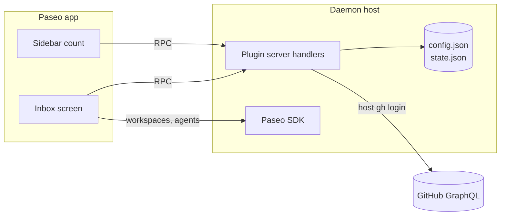
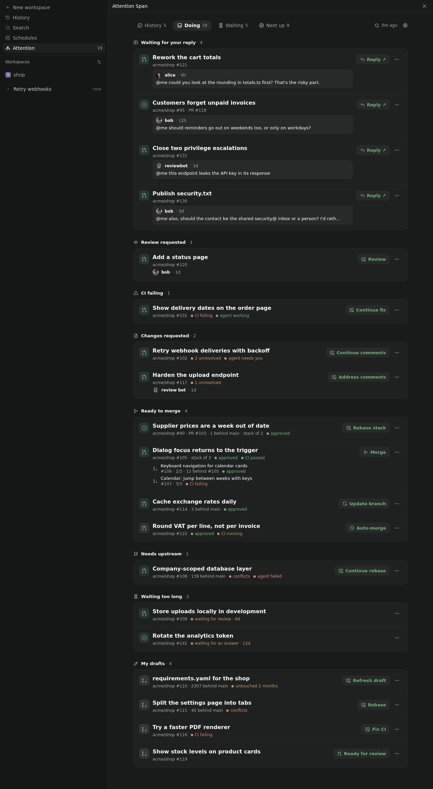
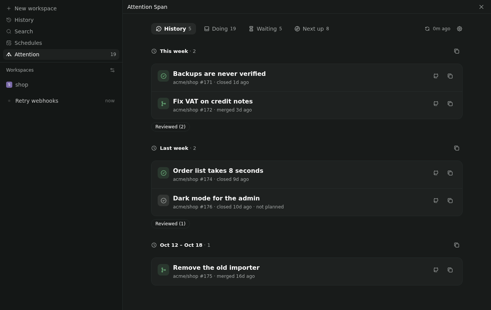
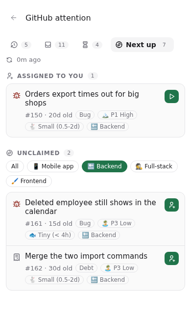

# Architecture

How the inbox meets [requirements.yaml](../requirements.yaml). Requirement IDs in brackets.

## Pieces

- **Paseo plugin**, installed per daemon.
  - Client: one screen and a sidebar header item. React Native primitives only, so it works on phone and desktop [REACH-01].
  - Server: RPC handlers for fetching and for GitHub actions.
- **GitHub access** goes through the host's existing `gh` login. The plugin stores no token [SEC-01].
- **Local files** live in `~/.config/paseo-github-attention/`:
  - `config.json`, edited by hand:
    - orgs and repos [SRC-01]
    - a profile per reason: `review` for Review, `default` for everything else
    - `waitingTooLongDays` (default 3) [ATT-11] and `refreshMinutes` (default 60) [FRESH-01], `historyWeeks` (default 4) [HIS-01]
    - optional prompt templates that replace the built-in ones [SES-04]
    - optional merge method per repo [PRS-04]
    - `nextUp`: repos and the org issue fields for priority, effort and scope [NXT-04]
  - `state.json`: dismissals [ATT-08] and the last fetched result, so the inbox shows instantly after a restart [PRIV-01].

## Tabs

The tabs tell the story of my work, left to right: what I finished, what needs me, what waits on others, what's next. The screen opens on **Doing**, and the sidebar entry "GitHub attention" shows Doing's count [ATT-09]. On phones only the active tab shows its label.

| Tab | Shows |
|---|---|
| History | The last `historyWeeks` (default 4) by week, newest first, in the device's time zone: issues assigned to me that closed, with the PRs that closed them, and my other merged PRs [HIS-01]. Per week, a collapsed "Reviewed (n)" lists others' merged PRs I reviewed [HIS-02]. |
| Doing | The sections below |
| Waiting | My work where someone else has the next move [WAI-01]: *Waiting for review* (with the requested reviewer), *Waiting for the reviewer* (after I replied or pushed), *CI running*, *Questions I asked* (issues where I commented last) |
| Next up | *Assigned to you* [NXT-06], then *Unclaimed* [NXT-01] |

Screenshots, from the preview's made-up data, are in [screenshots/](screenshots/). Refresh them with `npm run screenshots`.

| Doing | History | Next up (phone) |
|---|---|---|
|  |  |  |

### Doing

Top to bottom. Each item appears once, under its most urgent reason [ATT-02].

| Section | Shows |
|---|---|
| Waiting for your reply | Open threads with a mention waiting on me [MEN-01] |
| Review requested | PRs requesting my review by name, not via a team [REV-01] |
| CI failing | My PRs with failing checks [PRS-01] |
| Changes requested | My PRs with requested changes or unresolved threads [PRS-02] |
| Ready to merge | My approved, mergeable PRs [PRS-03] |
| Needs upstream | My PRs with conflicts or an out-of-sync stack [UPS-01, UPS-02] |
| Waiting too long | Waiting items older than `waitingTooLongDays` (default 3); it's mine to nudge [ATT-11] |
| My drafts | My drafts, with their own state tags [PRS-05, PRS-06] |

## Rules

- **One item per issue** [ATT-03]: PRs are grouped under the issues they close (`closingIssuesReferences`, works across repos). A PR without a linked issue is its own item.
- **One item per stack** [ATT-04]: a stack is followed through base/head branch names. Its section is decided by the bottom PR; the PRs above it are listed beneath.
- **Mentions** [MEN-01..06]: a thread counts when a person @-mentioned me after my last comment, review or reaction there. Team mentions are ignored. A bot counts only when it opened a thread I need to resolve, and is marked with 🤖.
- **Handed over** [PRS-08]: my PRs assigned to someone else, and not to me, are left out. Mentions of me on them still count.
- **Dismiss** [ATT-08] hides an item until someone other than me comments, reviews or pushes, or its reason changes. My own actions and CI reruns don't bring it back.
- **Behind base** [UPS-07] only matters when:
  1. the PR conflicts with its base,
  2. a stacked PR no longer builds on its parent's head,
  3. it is ready to merge (CI ran against an old base).
  Otherwise the behind count is shown on rows that appear anyway, but never puts an item on the list by itself. Its chip stays neutral; only conflicts are flagged, in red.
- **Stale draft** [PRS-07]: a draft untouched for 30 days offers Refresh and Close instead of Rebase.

## Next up

A second tab lists open issues nobody is assigned to [NXT-01], in the inbox's orgs and repos unless `nextUp.repos` is set. They are ordered by priority, then effort, then age [NXT-02]. Priority and effort are org issue fields named in `config.json`; a value ranks by the configured `order` (matched by name, so "Small" matches "🐇 Small (0.5-2d)") or else by the field's own option order. Issues without a value go last. Scope chips filter the list, starting from `nextUp.scope.mine` [NXT-03]. **Claim & start** assigns me with `gh issue edit --add-assignee @me`, then starts a "start" session on a new branch [NXT-05].

## Actions

| Action | Shown when | Does |
|---|---|---|
| Reply ↗ | Mention waiting | Opens the comment on GitHub [ATT-12] |
| Review ▸ | Review requested | Session in a PR checkout using the review profile [SES-01] |
| Fix ▸ / Address ▸ | CI failing / changes requested | Session with the failing log or unresolved threads in the prompt [SES-04] |
| Update ▸ | Behind with no conflicts, not stacked | `updatePullRequestBranch` (rebase) [UPS-03] |
| Rebase ▸ / Refresh ▸ | Conflicts, any stacked PR, stale draft | Agent rebases the PR, or the whole stack with `git rebase --update-refs` [UPS-04]. A clean rebase is pushed with `--force-with-lease` [UPS-06]. After resolving conflicts it stops and explains, and pushes only when I reply "push" in its session [UPS-05]. |
| Merge ▸ | Approved, CI green on current base | `mergePullRequest` with the repo's method from `config.json`, otherwise the first the repo allows of squash, merge, rebase [PRS-04] |
| Close ▸ | Stale draft | `closePullRequest`, with a comment only if I write one [SAFE-01] |

A tap starts with defaults. Expanding the row offers workspace, profile, and prompt [SES-02]. An existing workspace for the branch or PR is resumed instead of creating a new one [SES-03, ATT-07].

## Sessions

- **Repo to checkout** [SES-05]: match the PR's or issue's repository against the git remotes of registered Paseo projects. Repos without a project can only open GitHub.
- **Workspace**: a worktree with `checkout-pr` for PRs, or `branch-off` from the default branch for issues.
- **Profile**: looked up per reason in `config.json`, then materialised into `create_agent` from `list_profiles`. A missing `review` profile falls back to `default`; a missing `default` starts the agent with Paseo's defaults. Options ▾ still offers provider and model [SES-06].
- **Prompt**: a built-in template per session type, filled with the item's context. A template in `config.json` replaces the built-in one [SES-04]. The context is fetched when the session starts, mostly from `gh`'s JSON output: `gh pr checks` and `gh run view --log-failed` for Fix, `gh pr view`/`gh issue view` for Review and Start, one GraphQL query for unresolved threads for Address. Rebase uses the stack already in the item.

## GitHub requests

Fewest requests practical [GH-01]. A refresh is two GraphQL requests.

1. **One query with search aliases**:
   - `is:pr is:open author:@me`
   - `is:pr is:open user-review-requested:@me` (personal requests only)
   - `is:open mentions:@me updated:>=<30 days ago>` (fetching the description, recent comments, review-thread comments, and `viewerHasReacted`)
   - `is:issue is:open assignee:@me`
   - `is:issue is:open commenter:@me` (for issues waiting on others)
   - `is:issue is:open no:assignee` (Next up, with issue type and field values)
   - History: `is:pr is:merged author:@me`, `is:pr is:merged reviewed-by:@me -author:@me`, `is:issue is:closed assignee:@me`, each from the Monday `historyWeeks` back

   Each is scoped to the configured orgs and repos. With comment bodies for the mention rule and Next up, the query costs about 65 of 5,000 points per hour.
2. **One batched details query**: `Ref.compare` behind counts for my PRs, and the option order of org issue fields when Next up needs it.

It's a digest, not a live view. GitHub is asked every `refreshMinutes` (default 60, at least 5) in the background [FRESH-01], after my own actions, and on ⟳. Opening the screen shows the cache. A failed refresh is retried at most every 5 minutes. That's about 2 requests and 75 points an hour. Actions use GraphQL mutations or `gh`. Session context is fetched only when a session starts.

